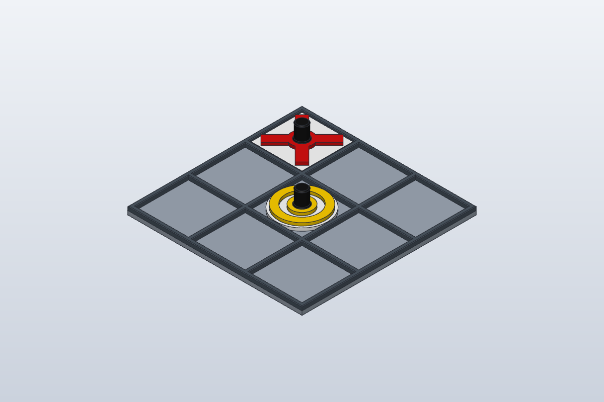

# Tic-tac-toe board and counters

Dedicated print files for the robot-arm board and the playing pieces. `two_part/` is the glue-together set. `tictactoe.solidcraft` is the SolidCraft source (millimetres). The PNG files are previews. STL headers and 3MF metadata name SolidCraft as the application that wrote the meshes.

Print **X in red** and **O in yellow**. Red is the arm; yellow is the human. The board camera uses those colours to tell the pieces apart.

## Board

`board.3mf` and `board.stl` are the 180×180 mm board. The 3MF contains two parts, `Board_Base` and `Board_Grid`. Each cell is 54.67 mm square.

`tictactoe_all.3mf` is the same board plus one flat X and one flat O (`Board_Base`, `Board_Grid`, `Counter_X`, `Counter_O`).

## One-piece counters

These print as a single part with a sealed pocket for an M8 washer. Pause the print at **Z 5.4 mm**, drop the washer in, then resume so the top layers close the pocket.

| File | Piece |
| --- | --- |
| `counter_X.stl`, `counter_O.stl` | Flat counters |
| `counter_X_tower.stl`, `counter_O_tower.stl` | Same counters with a grip tower |
| `counter_X_tower_parts.3mf`, `counter_O_tower_parts.3mf` | Tower counters as separate parts (`X_Base` / `X_Symbol` / `X_Tower`, and the O equivalents) |

## Two-part counters

`two_part/` holds glue-together base and cap versions of the flat and tower counters. Each pair is a `*_base.stl` and a `*_cap.stl`, with a matching `*_2part.3mf` that contains both parts (`Base` and `Cap`).

Files with `10mm` in the name fit a 10 mm washer. The pocket is 10.4 mm across, and the washer sits 1 mm under the top. The other files in this folder are the M8 washer versions.

## Previews

- `preview.png` — board with flat counters
- `preview_tower.png` — board with tower counters
- `counters.png`, `counters_tower.png` — the pieces on their own
- `counters_parts.png` — coloured parts (red X, yellow O)
- `two_part/preview_exploded.png` — base, M8 washer, and cap
- `two_part/preview_exploded_10mm.png` — base, 10 mm washer, and cap
